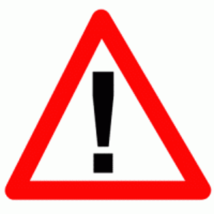
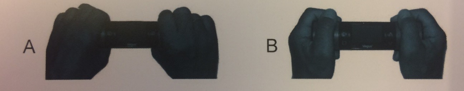

# Autonom funktion i DP-Next-projektet {#sec-autonomfunction}

## Baggrund

Det autonome nervesystem består af nerver til de indre organer og blodkar (f.eks. hjerte, blodtryk, vejrtrækning, mave-tarmfunktion). Ved autonom neuropati bliver disse funktioner påvirket. Mulige symptomer er bl.a. nedsat finjustering af puls, højt blodtryk om natten og lavt blodtryk når man rejser sig.

Formålet med undersøgelsen er at undersøge for nedsat hjerterytmevariabilitet. Dette gøres ved at måle HR i hvile, og ændringer i HR under 3 forskellige øvelser.

## Anvendelsesområde

-   Undersøgelsen udføres af projektpersonale, der er uddannet og autoriseret til at betjene Vagusapparatet.
-   Alle deltagere får foretaget undersøgelsen ved Visit 1.
-   Patienten skal være fastende fra midnat før vagus test
-   Patienterne bedes undgå koffein, nikotin og alkohol 8 timer før test.
-   Patienten bedes undgå hård motion 24 timer før.

## Udstyr og forberedelse

-   Vagus^TM^

-   Valsalva mundstykke

-   Undersøgelsesbriks

## Sikkerhed

-   Undersøgelsen udføres kun for patienter der er mellem 20 og 80 år, da der ikke findes referenceværdier udenfor dette interval (alle er mellem 40-55 år).
-   Hvis patienten har pacemaker eller atrieflimmer gennemføres undersøgelsen ikke.
-   Hvis patienten er i aktiv laserbehandling for proliferativ renopati gennemføres 4. test VM ikke.

## Data

Der produceres fire værdier:

HR: slag/min.

RS, E:I og VM: ingen, ratio

## Instruktioner

Se anvendelsesområde ift. instruktioner forud for undersøgelsen.

## Procedure

1.  Forberedelse
    1.  Spørg ind til sikkerhedsspørgsmål samt instruktioner
        1.  Der noteres om patienten har
            1.   Fastet fra midnat før undersøgelsen
            2.  Har røget, drukket alkohol eller indtaget koffeinholdige drikke 8 timer før undersøgelsen.
            3.  Hård motion 24 timer før undersøgelse
    2.  Inden undersøgelsen påbegyndes skal patienten vaske hænder og tage evt. ringe af.
    3.   Patienten skal hvile i 10 minutter på leje inden første måling
    4.  Patienten instrueres i hvordan hænderne skal placeres på Vagus apparatet (se billede under referencer), hvad der skal ske under hver måling (praktisk del), og at patienten ikke må tale eller lave andre bevægelser end instrueret under målingerne.
2.  Udførelse
    1.  Måling af HR i hvile
        1.  Vælg 1. HR på apparatet. Tryk på ON og giv patienten apparatet inden nedtælling er overstået.
        2.  Patienten ligger i 5 min. med apparatet i hænderne.
            1.  Et kort "bip" betyder godkendt måling, et langt "bip" (2 sek) betyder mislykket måling)
        3.  I displayet vises ud for 1. HR et undersøgelsesnr. samt resultat. Noter resultaterne i REDCap.
    2.  Måling af HR fra liggende til stående position
        1.  Patienten ligger på leje. Informer patienten om, at når apparatet afgiver et "bip" skal patienten rejse sig op med apparatet i hænderne.
        2.  Vælg 2. RS på Vagus apparatet. Tryk på ON, og giv patienten apparatet inden nedtællingen er overstået.
        3.  Når apparatet afgiver et ”bip” skal patienten rejse sig med apparatet i hænderne.
            1.  Hvis patienten ikke kan klare at komme op mens vedkommende holder apparatet, holder personalet det indtil patienten er kommet op og rækker vedkommende apparatet.
        4.  Tryk igen ON når patienten står oppe med apparatet i hænderne for at starte målingen.
        5.  Armene skal hænge afslappede under målingen.
        6.  Der måles i 1 min, et kort ”bip” angiver at undersøgelsen er slut.
        7.  Noter resultatet i REDCap
    3.  Måling af HR under dyb vejrtrækning
        1.  Patienten skal sidde afslappet på lejet under undersøgelsen. Informer patienten om, at når undersøgelsen starter (bip), skal patienten starte med at ånde ud, dernæst trække vejret ind gennem næsen, og puste ud gennem munden.
        2.  Vælg 3. E:I på Vagus apparatet og tryk på ON.
        3.  Giv patienten apparatet inden nedtælling er overstået.
        4.  Undersøgelsen starter ved at patienten ånder ud (vises på displayet). Herefter trækker patienten vejret ind gennem næsen, og puster ud gennem munden, i takt med ”barren” der vises på displayet.
            1.  Instruer patienten under målingen.
        5.  Målingen varer et minut, kort ”bip” = godkendt.  Noter resultatet i REDCap.
    4.  Måling af HR under ekspiration med modstand
        1.  Patienten skal sidde afslappet på lejet under undersøgelsen. Informer patienten om, at når undersøgelsen starter (bip), skal patienten trække vejret dybt ind og herefter puste ud i mundstykket i 15 sekunder.
        2.  Forbind Valsalva mundstykke ledningen til Vagus apparatet.
        3.  Vælg 4. VM på Vagus apparatet og tryk på ON.
        4.  Patienten holder apparatet i hænderne og har mundstykket i munden.
        5.  Patienten trækket vejret dybt ind (instruks på display), og når Vagus siger til puster patienten ud i mundstykket i 15 sek. Displayet viser om der pustes kraftigt nok. Efter 15 sek skal patienten fortsat holde fast med begge hænder.
            1.  Patienten må godt spytte mundstykket ud (eller personale tager det ud, med handsker på).
        6.  Instruér patienten løbende under undersøgelsen.
        7.  Målingen fortsætter i 1 min, kort ”bip” = godkendt.
        8.  Noter resultatet i REDCap
3.  Afslutning
    1.  Rengør Vagus apparatet med gul klud (Mediwipe).
    2.  Tør efter med et tørt papirhåndklæde, og sørg for at elektroderne er helt tørre.
    3.  Opbevar Vagus apparatet i den tilhørende kasse når det ikke er i brug.
    4.  Tag batterierne ud hvis Vagus ikke skal anvendes den næste måned eller mere

## Dokumentation og kvalitetskontrol

Udskiftning af elektroder efter ca. 50 undersøgelser.\
Skift batteri hvis der er \<1/3 tilbage.

## Afvigelser og fejl

+--------------------------------------+-------------+---------------------------------------------------------+--------------------------------------------------------------------+
| Display                              | Tekst       | Mulig årsag                                             | Anbefaling                                                         |
+======================================+=============+=========================================================+====================================================================+
| {width="105"} | Ustabile    | Mulig arytmi                                            | 1.  Hvis resultat \>100, gentag måling. Dog ikke mere end 3 gange. |
|                                      | slag        |                                                         | 2.  2\. Lav et standard EKG i amb.                                 |
+--------------------------------------+-------------+---------------------------------------------------------+--------------------------------------------------------------------+
| {width="105"} | Data        | Kvaliteten af data er ikke tilstrækkelig                | 1.Hold arme og hænder i ro\                                        |
|                                      | fejl        |                                                         | 2. Fugt hænderne\                                                  |
|                                      |             |                                                         | 3. Gentag måling. Dog ikke mere end 3 gange.\                      |
|                                      |             |                                                         | ​4. Skift evt. elektroderne                                         |
+--------------------------------------+-------------+---------------------------------------------------------+--------------------------------------------------------------------+
| {width="105"} | Lavt        | Patienten puster ikke ud kraftigt nok under VM målingen | Gentag                                                             |
|                                      | tryk        |                                                         | målingen. Dog ikke mere end 3 gange.                               |
+--------------------------------------+-------------+---------------------------------------------------------+--------------------------------------------------------------------+
|                                      | Område fejl | Resultatet ligger udenfor det målbare område            | 1.Gentag                                                           |
|                                      |             |                                                         | målingen. Dog ikke mere end 3 gange\                               |
|                                      |             |                                                         | ​2.Lav et standard EKG i amb.                                       |
+--------------------------------------+-------------+---------------------------------------------------------+--------------------------------------------------------------------+
|                                      |             |                                                         |                                                                    |
+--------------------------------------+-------------+---------------------------------------------------------+--------------------------------------------------------------------+

## Referencer

| 0   | Ingen           
       patologisk test  | Ingen                           
                         kardiel autonom neuropati (KAN)  |
|-----|-----------------|---------------------------------|
| 1   | En              
       patologisk test  | Grænse-kardiel                  
                         autonom neuropati (KAN)          |
| 2   | To              
       patologisk test  | Sikker                          
                         kardiel autonom neuropati (KAN)  |
| 3   | Tre             
       patologisk test  | Sikker                          
                         kardiel autonom neuropati (KAN)  |

+-----------------+-----------+-----------+-----------+-----------+-----------+-----------+
| **Alder:**      | **20-29** | **30-39** | **40-49** | **50-59** | **60-69** | **70-79** |
+-----------------+-----------+-----------+-----------+-----------+-----------+-----------+
| **Test 1. HR**  | \<100     | \<100     | \<100     | \<100     | \<100     | \<100     |
+-----------------+-----------+-----------+-----------+-----------+-----------+-----------+
| **Test 2. RS**  | \>1,15    | \>1,11    | \>1,07    | \>1,05    | \>1,02    | \>1,00    |
+-----------------+-----------+-----------+-----------+-----------+-----------+-----------+
| **Test 3. E:I** | \>1,24    | \>1,19    | \>1,15    | \>1,11    | \>1,08    | \>1,05    |
+-----------------+-----------+-----------+-----------+-----------+-----------+-----------+
| **Test 4. VM**  | \>1,42    | \>1,35    | \>1,29    | \>1,24    | \>1,19    | \>1,15    |
+-----------------+-----------+-----------+-----------+-----------+-----------+-----------+