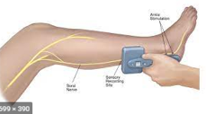

# Nerveledning i DP-Next-projektet {#sec-nerveledning}

## Baggrund

Undersøger sural nerveledning (Sural Nerve Conduction Study, NCS) for at vurdere perifer neuropati. Undersøgelsen måler ledningshastigheden og amplituden af nerveresponset.

## Anvendelsesområde

- Alle egnede deltagere i Aalborg får foretaget en NCS ved Visit 1.
- Testen udføres af DP-Next personalet efter oplæring.

## Udstyr og forberedelse

- Udstyr og materialer der skal bruges til undersøgelsen.

- Forberedelse af udstyr, lokale og deltagere forud for undersøgelsen.

- 1x ethanolservietter

- 1x elektrodegel/"Sigma gel"

- 1x engangselektroder/biosensor

- 1x apparat til nerveledningsundersøgelse/DPNCheck

- 1x undersøgelsesbriks

## Sikkerhed

Ikke relevant for denne undersøgelse.

## Data

Skærmen viser to værdier: Sural Nerve Conduction Velocity (SNCV, ledningshastigheden) og sural nerve amplitude potential (SNAP, amplituden).

## Instruktioner

Ikke relevant for denne undersøgelse.

## Procedure

1.  Forberedelse

    1.  Deltageren ligger på siden, så relevant ben er øverst (højre ben er første valg).
    2.  Afsprit benet i et område omkring ydre ankelkno og 10-15 cm op af ydersiden af benet.
    3.  Påsæt en hvid engangselektrode/biosensor i apparatet.
    4.  Placer en dråbe "Sigma Gel" eller tilsvarende elektrodegel på de to metalhoveder/prober på apparatet. Der skal være nok gel til det leder strømmen ordentligt, men ikke så meget at de to metalhoveder bliver "forbundet" af gelen.

2.  Udførelse

    1.  Tryk på knappen.
    2.  Placér de to prober bag ankelknoen og biosensoren op af benet, således at n. suralis forløb følges. Den lange metalelektrode (catode) placeres midt bag ankelknoen og engangselektroden på siden af læggen, så apparatets ene kant flugter læggens midtlinje uden at krydse den og peger mod bagsiden af knæet. Se billede under referencer som reference.
    3.  Pres apparatet ned med et fast tryk.
    4.  “l” og “r” vises nu på displayet.
        1.  Vælg “r” for højre ben/”l” for venstre
            1.  Vælg ved et enkelt tryk på knappen
            2.  Skift ved at holde knappen nede
            3.  Den der blinker, er man ved at vælge
    5.  Når der vælges, påbegyndes elektrisk stimulation
        1.  Der gives 5-10 stimulationer.
        2.  Skærmin viser herefter 2 tal:
            1.  Amplitude (SNCA) (tal med en firkant i hjørnet).
            2.  Ledningshastigheden (SNCV).\

    Afslutning

    1.  Tag billede af hvert tal sammen med deltagernummeret
    2.  Notér tallet i REDCap
    3.  Apparatet slukker af sig selv efter ophørt brug
    4.  Smid elektroden ud
    5.  Fjern gel med papir og afsprit de to metalhoveder med spritswabs

## Dokumentation og kvalitetskontrol

Angiv relevante kontroller og dokumentation under og efter undersøgelsen.

## Afvigelser og fejl

Ved fejlkode prøv følgende først:

1.  Tjek om der er for lidt/for meget gel.
2.  Flyt apparatet en smule (er måske ikke placeret korrekt i forhold til nervens forløb).

+-------+----------------------------------------------------------------------+--------------------------------------------------------------------------------------+
|       |                                                                      |                                                                                      |
+=======+======================================================================+======================================================================================+
| Kode  | Beskrivelse  /  Mulig årsager                                        | Løsning                                                                              |
+-------+----------------------------------------------------------------------+--------------------------------------------------------------------------------------+
| Lb    | Data kvalitets problem: Forkert ben valgt.                           | 1\. Tjek at det rigtige ben er valgt.                                                |
|       |                                                                      |                                                                                      |
|       |                                                                      | 2\. Hvis ikke så vælg det rigtige.                                                   |
|       |                                                                      |                                                                                      |
|       |                                                                      | 3\. Test igen                                                                        |
+-------+----------------------------------------------------------------------+--------------------------------------------------------------------------------------+
| Pn    | Data kvalitets problem: Der kunne ikke optages tilstrækkelig signal. | 1\. Tjek placeringen og test igen.                                                   |
+-------+----------------------------------------------------------------------+--------------------------------------------------------------------------------------+
| Pr    | Stimulations problem:                                                | 1\. Gentag hud præparation:                                                          |
|       |                                                                      |                                                                                      |
|       | 1.  Utilstrækkelig gel på prober.                                    | 1.  Skrub ankel området kraftigt.                                                    |
|       | 2.  Dårlig kontakt mellem prober og hud.                             | 2.  Rengør proberne og tilføj nyt gel.                                               |
|       | 3.  Utilstrækkelig hud præparation.                                  | 3.  Placér apparatet igen med et med et fast tryk på hele apparatet.                 |
|       | 4.  Bevægelse af probe.                                              |                                                                                      |
|       | 5.  Gelkontakt mellem de to prober.                                  | 2\. Test igen med konstant tryk og uden bevægelse.                                   |
+-------+----------------------------------------------------------------------+--------------------------------------------------------------------------------------+
| Sn    | Biosensoren afbrudt under test.                                      | 1\. Genplacér biosensoren med enden helt nede i slidsen. Test igen.                  |
|       |                                                                      |                                                                                      |
|       |                                                                      | 2. Hvis fortsat problem: Udskift biosensoren.                                        |
+-------+----------------------------------------------------------------------+--------------------------------------------------------------------------------------+
| Sn    | Data kvalitets problem.                                              | 1\. Fjern biosensor beskyttelsen og test igen.                                       |
|       |                                                                      |                                                                                      |
|       | Mulig årsag:                                                         | 1.  Tjek for god kontakt på begge sider af skumpuden.                                |
|       |                                                                      |                                                                                      |
|       | 1.  Biosensorens beskyttelse ikke fjernet.                           | 2\. Hvis forsat problem: Præparér huden igen og placér en ny biosensor og test igen. |
|       | 2.  Ufuldstændig biosensor kontakt.                                  |                                                                                      |
|       | 3.  Huden under biosensoren ikke ordentligt præpareret.              |                                                                                      |
+-------+----------------------------------------------------------------------+--------------------------------------------------------------------------------------+
| Ec    | Data kvalitets problem.                                              | 1\. Sikre at patienten slapper af i lægmusklen.                                      |
|       |                                                                      |                                                                                      |
|       | Mulig årsag:                                                         | 2\. Omplacér patienten om nødvendigt.                                                |
|       |                                                                      |                                                                                      |
|       | 1.  Signal forurening pga. patient bevægelse eller                   | 3. Test igen.                                                                        |
|       |     overdreven muskel sammentrækning.                                |                                                                                      |
+-------+----------------------------------------------------------------------+--------------------------------------------------------------------------------------+
| Ec    | Data kvalitets problem.                                              | 1\. Fjern biosensor beskyttelsen og test igen.                                       |
|       |                                                                      |                                                                                      |
|       | Mulig årsag:                                                         |                                                                                      |
|       |                                                                      |                                                                                      |
|       | 1.  Biosensorens beskyttelse ikke fjernet.                           |                                                                                      |
+-------+----------------------------------------------------------------------+--------------------------------------------------------------------------------------+
| °C    | Patientens ankel er kold.                                            | 1\. Vær sikker på at din hånd ikke hindrer temperaturdetektoren.                     |
|       |                                                                      |                                                                                      |
|       | Mulig årsag:                                                         | 2\. Varm patientens læg op:                                                          |
|       |                                                                      |                                                                                      |
|       | 1.  Temperaturdetektorens arbejdsfelt er blokeret.                   | 1.  Giv en strømpe på og hæv benet op.                                               |
|       |                                                                      | 2.  Hvis det ikke virker, så:                                                        |
|       | Patientens ankel er \<23°C.                                          |     1.  Bed patienten tage sko og strømper og gå rundt for 1-2 min. hvis muligt.     |
|       |                                                                      |                                                                                      |
|       |                                                                      | Eller                                                                                |
|       |                                                                      |                                                                                      |
|       |                                                                      | 1.  Vikkel tæppe eller varmepude rundt om benet.                                     |
|       |                                                                      |                                                                                      |
|       |                                                                      | Eller                                                                                |
|       |                                                                      |                                                                                      |
|       |                                                                      | 1.  Gnid patientens ben varmt (ikke ideelt)                                          |
|       |                                                                      |                                                                                      |
|       |                                                                      | Test igen                                                                            |
+-------+----------------------------------------------------------------------+--------------------------------------------------------------------------------------+
| Lo    | Lavt batteri                                                         | 1\. Udskift batteriet.                                                               |
+-------+----------------------------------------------------------------------+--------------------------------------------------------------------------------------+
| Hd    | Hardware problem                                                     | 1\. Kontakt Customer Service                                                         |
+-------+----------------------------------------------------------------------+--------------------------------------------------------------------------------------+
| Ub    | Overdreven genbrug af biosensor.                                     | 1\. Kontakt Customer Service                                                         |
|       |                                                                      |                                                                                      |
|       | Apparatet er deaktiveret.                                            |                                                                                      |
+-------+----------------------------------------------------------------------+--------------------------------------------------------------------------------------+

## Referencer

