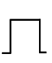
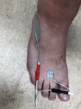
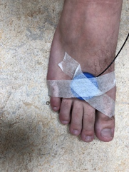

# Sensorisk funktion i DP-Next-projektet {#sec-sensoriskfunktion}

## Baggrund

Sensorisk funktion, perception threshold tracking (PPT), af store og små sensoriske fibre i huden, vurderes ved hjælp af en standardiseret metode, hvor deltageren udsættes for elektrisk stimulation.

## Anvendelsesområde

- Alle egnede deltagere i Aalborg får foretaget en sensorisk funktionstest ved Visit 1.
- Testen udføres af DP-Next personalet efter oplæring.

## Udstyr og forberedelse

- Spritswabs til rengøring af huden.
- 1x Digitimer DS5 (eller tilsvarende) til måling af tærskelværdier.
- 1x PC
- 1x elektrodegel.
- 1x pladeelektrode/patch elektrode.
- 1x pin-elektrode.
- 1x undersøgelsesbriks

## Sikkerhed

Ikke relevant.

## Data

Der genereres en Matlab-fil med data for tærskelværdier for store og små sensoriske fibre i huden, som kan bruges til at vurdere sensorisk funktion.

## Instruktioner

Ikke relevant.

## Procedure

1.  Forberedelse
    1.  Deltageren lejres på briksen, siddende tilbagelænet eller liggende.
    2.  Sprit foden af hvor elektroderne skal sidde (se billede).
    3.  Tænd Digitimer DS5 på bagsiden.
    4.  Tænd Pc'en ved at tænde skærmen på forsiden (nedre højre hjørne).
        - Login-koden er ”XXX”.

        - Åbn programmet "LabBench Runner (PTT)" på Skrivebordet.

        - Vælg "DP-Next".

        - Tryk "Next".

        - Indtast ID

        - Tryk "Next".

        - Tryk "Start"
    5.  Overskriften **"PATCH ELECTRODE"** fremkommer.
    6.  Følg Instruktionen på skærmen for at lave korrekte indstillinger
    7.  Tilslut patch-elektroder til deltagerens fod: (lille til sort, stor til rød).
        1.  Stor patch - på siden af foden
        2.  Lille patch - 2-3 cm proximalt for 2-3. tå
        3.  Undgå påsætning direkte over knogle
    8.  Tilslut patch-elektroder til Digitimer DS5 (rød til rød, sort til sort).
    9.  Giv deltageren metalstangen med knappen i hånden
    10. Læs teksten højt
        1.  ”*Du skal trykke HVER GANG der mærkes en impuls. Hold ikke knappen nede hvis det føles som konstant stimulation, men tryk i stedet gentagne gange. Der kommer to serier, som hver tager ca. 3-4 min. Der kan komme nogle lyde – prøv at ignorere dem.  Der skal være stille i rummet, og du skal prøve at koncentrere dig så godt du kan. Du må gerne lukke øjnene*.”
2.  Udførelse
    1.  Tænd strømmen (skub den røde switch opad):
        1.  Ikonet {width="20"}ses i nedre højre hjørne, hvis ikke se boks øverst på siden.
    2.  Deltageren må ikke kunne se skærmen.
    3.  Tryk "Play" på PC (øvre venstre hjørne/grøn knap).
    4.  Første serie er færdig:
        1.  Kontrollér Digitimer DS5: Intet blinkende ikon i nederste venstre hjørne → OK.
        2.  Blinkende ikon:
            1.  Påbegyndt test færdiggøres først.
            2.  Sluk Digitimer DS5 på den røde switch.
            3.  Tryk på knappen F2 AZ (ikonet holder op med at blinke).
            4.  Tænd igen strømmen på den røde switch.
            5.  Fortsæt undersøgelsen.
    5.  Tryk ”Play” igen (med samme elektrode).
    6.  Anden serie færdig:
        1.  Sluk strømmen.
        2.  Fjern elektroderne og kablerne.
    7.  Overskriften **"PIN ELEKTRODE"** er fremkommet:
        1.  Følg Instruktionen på skærmen for at lave korrekte indstillinger.
    8.  Påsæt Pin-elektroden.
        1.  Metalringen skal berøre huden hele vejen rundt (har deltageren markerede sener, sættes den højere oppe).
    9.  Tilslut til Digitimer DS5 (rød til rød, sort til sort)
    10. Læs teksten højt:\
        *”Undersøgelsen begynder snart igen. Der kommer igen to serier på 3-4 min hver.\
        Det kan prikke lidt, især ved nr. 2. Du skal trykke HVER GANG der mærkes en impuls.\
        Hold ikke knappen nede hvis det føles som konstant stimulation, men tryk i stedet\
        gentagne gange. Der kan komme nogle lyde – prøv at ignorere dem.  Der skal være\
        stille i rummet, og du skal prøve at koncentrere dig så godt du kan.”*
    11. Tænd strømmen (skub den røde switch opad):
        1.  Ikonet XXX ses i nedre højre hjørne, hvis ikke se boks øverst på forrige side.
    12. Deltageren må ikke kunne se skærmen.
    13. Tryk "Play" på PC (øvre venstre hjørne/grøn knap).
    14. Første serie er færdig:
        1.  Kontrollér Digitimer DS5: Intet blinkende ikon i nederste venstre hjørne → OK.
            1.  Blinkende ikon:
                1.  Påbegyndt test færdiggøres først.
                2.  Sluk Digitimer DS5 på den røde switch.
                3.  Tryk på knappen F2 AZ (ikonet holder op med at blinke).
                4.  Tænd igen strømmen på den røde switch.
                5.  Fortsæt undersøgelsen.
    15. Tryk ”Play” igen (med samme elektrode).
3.  Afslutning
    1.  Anden serie færdig:
        1.  Sluk strømmen.
        2.  Fjern elektroden og kablet.
    2.  Luk programmet.
    3.  Sluk Digitimer DS5 på bagsiden.
    4.  Åben RedCap på PC’en:
        1.  Overfør deltagerens Matlab-fil til RedCap.
    5.  Aftørres med sæbeklud: Trykknappen og alle kabler.
    6.  Aftørres med lille sprit swab: Pin elektrodens metalring og ”nåle”.

## Dokumentation og kvalitetskontrol

Sikker korrekt indtastning af deltager ID samt overførsel til REDCap

## Afvigelser og fejl

Ved afbrudt test registreres årsag i REDCap.

## Referencer

Drillende Digitimer DS5:

Melder den "Self-test failed" slukkes den på bagsiden, hvorefter den tændes, mens knapperne "F1 MENU" og "F2 AZ" holdes nede samtidig.

Ovenfor ses patchelektrode

{width="138"}

Ovenfor ses pinelektrode